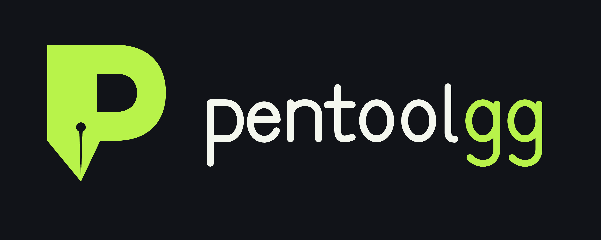
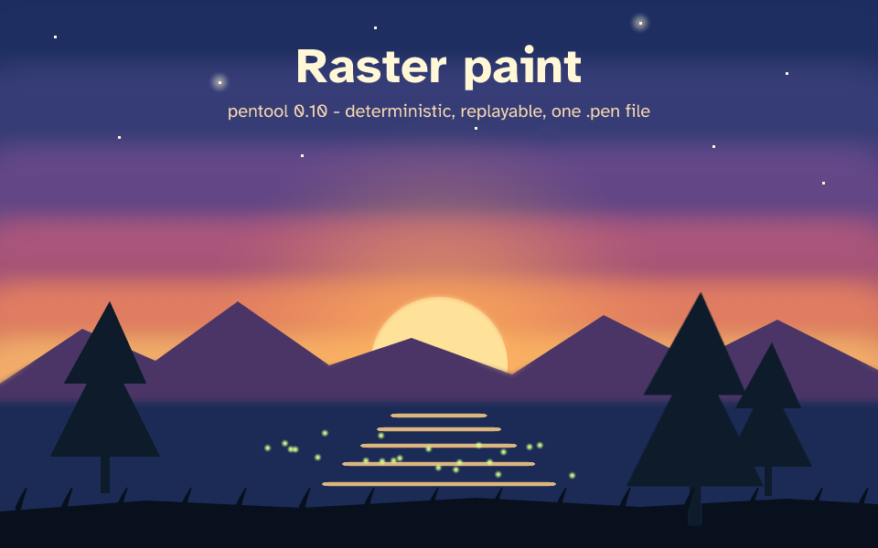
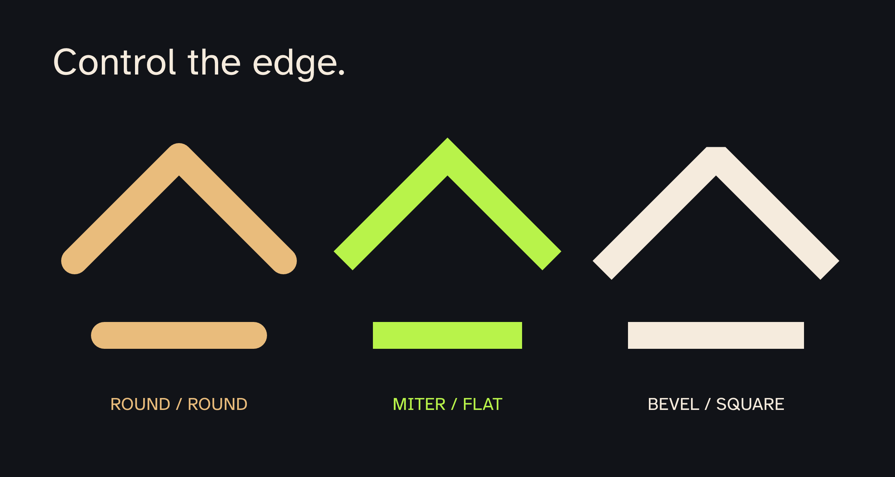
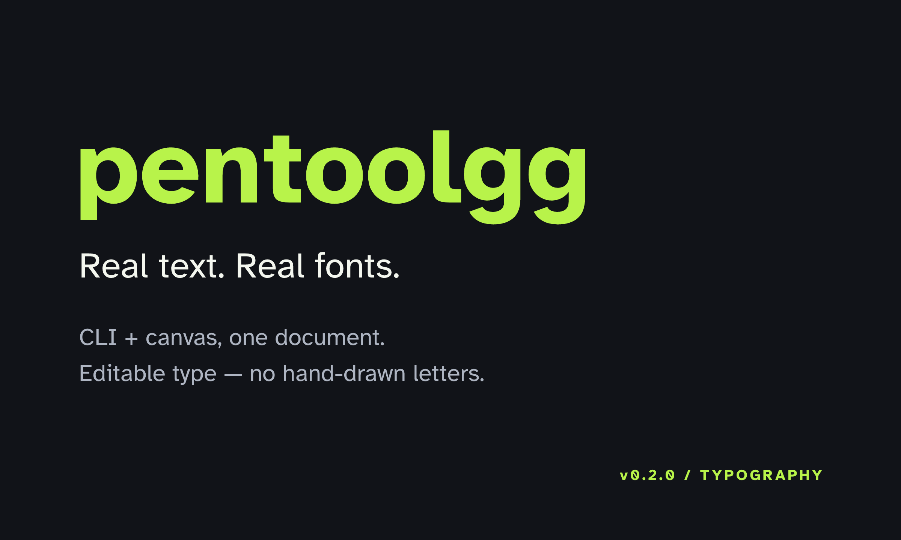

# Pentool



[Vector logo](examples/pentoolgg-logo.svg) · [Transparent icon](examples/pentoolgg-icon.png) · [Editable logo](examples/pentoolgg-logo.pen)

Pentool is an open-source, agent-friendly vector editor distributed as **one Rust binary**. It serves a browser canvas, stores editable layered artwork in a readable `.pen` JSON format, exposes rendering APIs, and exports PNG, SVG, PDF, or flattened and layered PSD.

AI agents can draw through CLI commands; humans can edit the same artwork visually.


Try the bundled examples: `pentool serve examples/eye.pen` or
`pentool serve examples/xyskid.pen`. The eye consists of eight paths on three
artwork layers. Its 15 CLI commands, including two exports, executed in 0.202
seconds on the development machine; this excludes design time and is not a
general performance guarantee.

## Install

macOS and Linux:

```sh
curl -LsSf https://pentool.space/install.sh | sh
```

Windows PowerShell:

```powershell
irm https://pentool.space/install.ps1 | iex
```

The installer downloads the latest release for your platform, verifies its
SHA-256 checksum, installs `pentool`, and adds its directory to your user
`PATH`. Restart your terminal if this is the first installation, then run:

```sh
pentool serve
```

Open `http://127.0.0.1:4711`. No Node.js, database, or external assets are required.

To install a specific release or choose another directory, set
`PENTOOL_VERSION` (for example, `v0.6.2`) or `PENTOOL_INSTALL_DIR` before
running the command. You can also download an archive directly from
[GitHub Releases](https://github.com/agkomyint/pentoolgg/releases).

Build from source:

```sh
cargo install --path .
```

## CLI

**v0.3.0** adds searchable object discovery, targeted partial edits, recoverable
batch operations, and a searchable browser object tree. Text, fonts, and sharp
stroke controls introduced in v0.2.0 remain fully supported.

```sh
pentool serve --host 127.0.0.1 --port 4711
pentool new logo.pen --width 1200 --height 800   # refuses an existing file; add --overwrite (undo-able)
pentool info logo.pen
pentool export logo.pen logo.png --scale 2
pentool export logo.pen logo.svg
```

Running `pentool` without a command starts the server.

## Comments and review states (v0.20, in development)

Threads, `@mentions` and review states live in a sidecar next to the document
(`.pentool/comments/<name>.json`). Commenting never changes the `.pen` bytes,
its revision, rendering or export. The contract is
[`docs/collaboration-comments.md`](docs/collaboration-comments.md).

```sh
pentool comment add logo.pen "Tighten this, @ana" --object title --author Ana --actor-id ana
pentool comment add logo.pen "Check the corner" --x 12 --y 8
pentool comment reply logo.pen t-1 "Done" --kind agent --actor-id bot-1 --author Painter --model claude --directed-by ana
pentool comment review logo.pen t-1 requested        # none | requested | approved | changes-requested
pentool comment resolve logo.pen t-1 --if-version 2  # refuses a stale thread version
pentool comment reopen logo.pen t-1
pentool comment list logo.pen --status open --limit 20 --json
pentool comment list logo.pen --thread t-1           # one thread with every comment
```

The shared server exposes the same operations as `GET /api/comments` (filters
and `offset`/`limit`) and `POST /api/comments` (`action` of `add`, `reply`,
`resolve`, `reopen` or `review`).

## Extensions (v0.18)

Sandboxed WebAssembly extensions read a document and propose edits through the
same planner and transaction as `pentool batch` (dry run, revision guard, locks,
rollback, one undo step). They get no filesystem, network, clock or randomness,
and run under fixed CPU and memory limits. Capabilities are declared in the
manifest and shown before install. See [docs/extensions-v1.md](docs/extensions-v1.md).

```sh
pentool extension pack examples/extensions/stamp/package stamp.penext
pentool extension verify stamp.penext
pentool extension add stamp.penext                 # shows capabilities, installs nothing
pentool extension add stamp.penext --approve
pentool extension run stamp logo.pen --args '{"text":"SALE"}' --dry-run
pentool extension list
pentool extension remove stamp
```

## 3D mockups and UVs (v0.16 in development)

Pentool imports GLB, glTF, and OBJ models into ordinary `.pen` scene nodes.
Format v10 supports model import and static rendering; v11 adds linked product
artwork and editable UV islands. Migrations are explicit:

```sh
pentool migrate products.pen --target 10
pentool scene3d products.pen add bottle --model bottle.glb --layer mockups --page front
pentool scene3d products.pen uv bottle show
pentool scene3d products.pen uv bottle project --primitive 0 --projection cylindrical --axis y
pentool migrate products.pen --target 11
pentool mockup list --json
pentool mockup apply products.pen --preset perfume-bottle --id bottle-preview --layer mockups --page products --width 400 --height 600 --dry-run --json
pentool mockup apply products.pen --preset perfume-bottle --id bottle-preview --layer mockups --page products --width 400 --height 600 --if-revision 0123456789abcdef --json
pentool scene3d products.pen form presets
pentool scene3d products.pen form add bottle-preview --form bottle --preset perfume-bottle --layer mockups --page front --width 400 --height 600
pentool scene3d products.pen dependencies
pentool scene3d products.pen render-report bottle-preview
pentool scene3d-cache --server http://127.0.0.1:4711 status
pentool scene3d-cache --server http://127.0.0.1:4711 clear
pentool scene3d products.pen batch --node bottle-preview --node carton-preview --out-dir mockup-renders
# For page-local duplicate IDs, qualify the selector as PAGE::ID.
pentool scene3d products.pen batch --node products::bottle-preview --node alternate::bottle-preview --out-dir mockup-renders
pentool scene3d mockup-queue.json batch-queue --out-dir all-mockups --cancel-file cancel.request
pentool scene3d products.pen uv bottle island add --primitive 0 --id label --uv-set 0 --triangles 12,13,14 --scale 0.8,0.8 --offset 0.1,0
pentool scene3d products.pen uv bottle island set --primitive 0 label --rotate 12
pentool scene3d products.pen uv bottle layout --primitive 0 --out bottle-uv.svg
pentool scene3d products.pen graphic bottle add label-art --source page:front --slot label --mode decal
pentool scene3d products.pen pack sleeve --dieline sleeve --node sleeve-preview --layer mockups --length-mm 120 --width-mm 70 --height-mm 180 --dry-run
pentool scene3d products.pen pack carton --dieline carton --node carton-preview --layer mockups --template straight-tuck --length-mm 120 --width-mm 80 --height-mm 220 --dry-run
pentool scene3d products.pen pack tube --dieline label --node tube-preview --layer mockups --radius-mm 30 --height-mm 140 --overlap-mm 3 --dry-run
pentool scene3d products.pen pack pouch --dieline pouch --node pouch-preview --layer mockups --front-width-mm 120 --gusset-mm 35 --height-mm 180 --dry-run
pentool scene3d products.pen pack bottle-label --dieline bottle-label --node label-preview --layer mockups --radius-mm 30 --height-mm 90 --overlap-mm 3 --dry-run
pentool pack products.pen import imported-carton --svg carton.svg --node imported-preview --layer mockups --dry-run
pentool scene3d products.pen pack carton --dieline mailer --node mailer-preview --layer mockups --template mailer --length-mm 180 --width-mm 120 --height-mm 35 --glue-flap-mm 18 --dry-run
pentool scene3d products.pen pack crease carton front-body-fold --angle-deg -45 --direction mountain --dry-run
pentool scene3d products.pen pack settings carton --board-mm 0.5 --bleed-mm 3 --dry-run
pentool scene3d products.pen pack settings bottle-label --seam-angle-deg 42 --wrap-direction counterclockwise --dry-run
pentool scene3d products.pen pack preview carton --fold 0.75 --out carton-preview.png
pentool scene3d products.pen pack templates
pentool scene3d products.pen pack inspect carton
pentool scene3d products.pen pack preflight carton --min-ppi 300
pentool scene3d products.pen pack export carton --out carton-flat.svg --min-ppi 300
pentool scene3d products.pen pack separate carton --out carton-plates --ppi 300 --bits 8
pentool scene3d products.pen pack vector-separate carton --out carton-vector-plates
pentool pack products.pen export-bundle carton --out dist/carton --min-ppi 300 --ppi 300 --fold 1
pentool pack verify-bundle dist/carton
pentool pack templates
pentool pack products.pen inspect carton
pentool pack products.pen preflight carton --min-ppi 300
pentool serve products.pen
```

`mockup list` prints the offline starter catalog as JSON. `mockup apply` creates
an ordinary editable product form plus its scene node in one validated
transaction; the form record ID is deterministically derived as `<node-id>-form`.
The command supports `--dry-run` and `--if-revision`, and JSON reports are the
default (`--json` is accepted for consistency with other commands).

The `batch-queue` manifest lists up to eight documents and their selected
mockups; document paths are relative to the manifest. It preflights aggregate
work before rendering, stages the whole queue, and atomically publishes one
output directory. Individual render failures are reported per item while the
successful PNGs are published together; a summary reports rendered/failed
counts. Creating the optional cancel marker stops between renders and discards
all staged output. See `docs/scene3d-batch-queue.schema.json` for the manifest
contract and `docs/scene3d-v2.md` for the report behavior.

Packaging preview and SVG export accept `--if-revision REV`; successful JSON
reports include the exact source document revision, while stale guards fail
before creating an output file. `--dry-run` performs the same preview/export
work and reports planned bytes without creating or replacing its destination;
this applies to folded PNG, flat SVG, and PDF/X draft export.
`pentool pack DOC export ID --out proof.pdf --pdfx --ppi 300` creates a
flattened PDF/X-4 draft through the document's declared CMYK output role. Its
technical marks are process-color raster content, not spot separations, and it
is not a certified manufacturing file; keep the SVG for editable cut paths.
SVG dieline import is a bounded subset: explicit millimeter dimensions and
viewBox, named rectangular panels, labeled production paths, and straight
creases with explicit direction and angle. Unsupported SVG geometry is refused.
`pentool pack verify-bundle DIR` checks every hash-listed bundle artifact and
rejects missing, modified, or out-of-bundle files. It also checks that the
cutting map retains its reference-only legend and that each vector spot plate
declares one finishing role matching its manifest ink. It also compares the
map's cut/fold path geometry to `flat.svg`; this verifies handoff integrity,
not manufacturing readiness or certification.

Island triangle numbers are zero-based within a model primitive. Island changes
are stored as overlays; imported model bytes remain unchanged. Studio's 3D
workspace can edit linked artwork and UV islands, and previews/exports use the
Rust reference renderer. Studio can generate simplified sleeve, straight- or
reverse-tuck carton, hinged-lid mailer, stand-up pouch, tube-label, and
cylindrical bottle-label mockups, with a static fold preview for panel nets.
These are visual design nets, not manufacturing dielines. Positive board
thickness adds inner panel faces and exposed cut-edge walls, offsets fold axes
to keep the outer seams connected, and bridges the interior wedge at folded
hinges. That bridge is visual only; score compression, cut/fold allowances,
collision-free structural geometry, and certified production output are not
modeled.
The flat SVG export includes linked artwork and stored technical paths; vector
art stays vector and unsupported source content is embedded as bounded PNG with
an effective-ppi warning. Configured bleed expands the flat export and extends
raster artwork along eligible cut edges; crease edges and wrap seams are
excluded. The editor also supports 3D face selection/art placement and UV island
packing. Broader carton structures, profile-conforming bottle labels, and
manufacturing conformance remain in development; see the [v0.16
roadmap](docs/roadmap/v0.16.0/TASKS.md) and
[v11 3D contract](docs/scene3d-v2.md) (schema:
[`docs/pen-format-v11.schema.json`](docs/pen-format-v11.schema.json); upgrade with
`pentool migrate FILE --target 11`) for current limits.

## ICC profile tools (v0.12 in development)

Inspect a local ICC profile and validate a requested transform without changing
a document:

```sh
pentool color profile inspect docs/fixtures/print-CGATS21_CRPC7.icc --limit 10 --json
pentool color profile validate docs/fixtures/print-CGATS21_CRPC7.icc --direction pcs-to-device --intent relative-colorimetric --json
```

Inspection returns the original SHA-256, bounded description/copyright metadata,
paginated tag headers, and supported intent/direction paths with diagnostics.
`--offset` and `--limit` apply to tags; limits are 1–256. ICC version is reported
as `icc_version`; the report's `version` identifies its JSON contract.
Validation checks only the requested profile path and refuses a missing or
unsupported path. It does not certify ICC or PDF/X conformance. These commands
are offline and read only.

Explicitly migrate an existing document to v8 before importing profiles:

```sh
pentool migrate campaign.pen --target 8 --dry-run
pentool migrate campaign.pen --target 8
pentool migrate campaign.pen --target 11 --dry-run
pentool color profile import campaign.pen docs/fixtures/print-rgb-linear-v4.icc --name rgb-probe --redistribution allowed --dry-run
pentool color profile import campaign.pen docs/fixtures/print-rgb-linear-v4.icc --name rgb-probe --redistribution allowed
pentool color profile list campaign.pen --limit 10 --json
pentool color profile show campaign.pen --name rgb-probe --limit 10 --json
pentool color profile embed campaign.pen --name rgb-probe --dry-run
pentool color profile collect campaign.pen --dry-run --json
pentool color profile remove campaign.pen --name rgb-probe --dry-run --json
```

Import stores the original bytes by SHA-256 without assigning a role or changing
appearance. Mutations support `--dry-run` and `--if-revision`. Optional
`--external profiles/press.icc` verifies an existing document-relative copy;
`embed` makes its verified bytes self-contained. Redistribution defaults to
`unknown`; use a declaration supported by the profile's license. Downgrading
refuses retained profiles. See the developing [v8 catalog contract](docs/professional-color-v1.md#implemented-catalog-foundation)
for limits and validation. Production compositing and print delivery remain in development;
see the [v0.12 roadmap](docs/roadmap/v0.12.0/TASKS.md).

`collect` embeds every ICC catalog entry in one transaction. Sharing collection
requires declared `allowed` redistribution; `--local-only` permits a private
copy while preserving restricted/unknown declarations. Existing `.penpkg`
packaging requires embedded, redistributable ICC dependencies and verifies its
profile audit table. `remove` deletes an unused profile and all aliases; a paint
reference anywhere in the document rejects removal. External source files stay
in place. These commands support dry runs, revision guards and undo.

Configure document conversion targets without changing stored paint samples:

```sh
pentool color role list campaign.pen --json
pentool color role assign campaign.pen working --to '{"space":"display-p3:linear"}' --dry-run --json
pentool color profile import campaign.pen docs/fixtures/print-CGATS21_CRPC7.icc --name press-coated --redistribution allowed
pentool color role assign campaign.pen output --to '{"space":"icc-cmyk","profile":"press-coated"}' --intent relative-colorimetric --json
pentool color role evaluate campaign.pen output --color '{"space":"srgb","channels":[0.2,0.4,0.7]}' --json
pentool color paints convert campaign.pen --role output --include-shared --dry-run --json
pentool color role clear campaign.pen output --dry-run --json
```

Roles are `working`, `proof`, `display` and `output`. Assignment validates required
ICC paths and stores profile hashes; it supports dry runs, revision guards and
undo. Working/display default to linear sRGB/sRGB. Proof/output require explicit
settings. Role conversion uses its stored intent, so `--role` conflicts with an
explicit `--intent` or other destination flags. Profile removal refuses assigned
dependencies. Current consumers are sample evaluation and explicit paint edits;
paper/ink proof rendering and role-aware production exports remain in development.

Inspect visible paint samples through a verified CMYK output profile:

```sh
pentool inspect ink campaign.pen --profile profile:press-coated --tac-limit 300 --small-text-points 8 --units-per-inch 72 --limit 100 --json
```

The read-only report gives profile-derived C/M/Y/K channels, TAC, black and neutral
classifications, and small-text warnings. Omit `--profile` to use the document's
assigned output role and intent. The thresholds are explicit inputs; `--page`,
`--offset`, and `--limit` select a bounded page of records. Each record describes
a declared visible paint or gradient stop, not rendered area or a separation plate.

Evaluate a native color sample without editing the document:

```sh
pentool color evaluate docs/fixtures/print-v8.pen --color '{"space":"display-p3","channels":[1,0,0],"alpha":0.4}' --to '{"space":"srgb"}' --json
pentool color evaluate campaign.pen --color '{"space":"icc-rgb","profile":"rgb-probe","channels":[0.2,0.4,0.7]}' --to '{"space":"lab-d50"}' --intent relative-colorimetric --json
pentool color separate campaign.pen --out plates   # C,M,Y,K + spot plate PNGs and separations.json
pentool color pdfx campaign.pen campaign-x4.pdf --ppi 300   # flattened CMYK PDF/X-4 draft, unvalidated
pentool color preflight campaign.pen --min-ppi 150   # structured print issues with stable codes
pentool color preflight campaign.pen --max-total-ink 300   # flag pixels above 300% total ink
pentool color pdfx campaign.pen out.pdf --recipe magazine-print.json   # recipe supplies intent/ppi; flags override
pentool color package campaign.pen --out pkg && pentool color package-verify pkg   # PDF/X draft, plates, profiles, manifest
```

The report includes physical D50 XYZ, original and converted channels, alpha,
clipping, verified profile hashes, and selected ICC paths. Named RGB and ICC
device channels use [0,1]; Lab uses physical L*, a*, b*. Alpha defaults to 1 and
is preserved separately. See the [sample grammar](docs/color-value-v1.schema.json).
V8 vector/background paints, solid fills, gradient stops and effect colors
can also retain these native values. See the small
[native paint fixture](docs/fixtures/print-v8-native.pen). Ordinary exports
evaluate them into an sRGB8 preview while preserving stored channels. Native
plate compositing, raster interpretation, channel adjustments and print delivery
remain in development; sample evaluation does not assign or convert objects.

Interpolate numeric samples in an explicit channel space, with separate alpha:

```sh
pentool color interpolate docs/fixtures/print-v8.pen --from '{"space":"srgb","channels":[0,0,0]}' --to '{"space":"srgb","channels":[1,1,1]}' --space '{"space":"srgb:linear"}' --position 0.5 --json
```

Endpoints convert once using the selected intent. Same-profile CMYK retains all
four device channels; Lab retains physical values. Reports include converted
endpoints, clipping and profile hashes. This read-only sampler does not change
scene gradients or composite alpha.

V8 fill gradients can also declare a native interpolation space and intent:

```sh
pentool export docs/fixtures/print-v8-gradient.pen native-gradients.png
```

The fixture compares linear RGB, physical Lab and an authored CMYK numerical
probe. Native channels interpolate before preview conversion, with separate
straight alpha. Existing `"space":"srgb"` and `"space":"linear"` gradients
retain their released behavior. See the [native gradient contract](docs/professional-color-v1.md#implemented-native-fill-gradients)
for JSON, required ICC paths and limits. These exports are RGB previews.

Assign or convert the selected page's stored vector paints with an atomic edit:

```sh
pentool color paints assign campaign.pen --to '{"space":"display-p3"}' --dry-run --json
pentool color paints convert campaign.pen --to '{"space":"lab-d50"}' --dry-run --json
pentool color profile import campaign.pen docs/fixtures/print-CGATS21_CRPC7.icc --name press-coated --redistribution allowed
pentool color paints convert campaign.pen --to '{"space":"icc-cmyk","profile":"press-coated"}' --intent relative-colorimetric --include-shared --json
pentool color paints convert campaign.pen --legacy-srgb --all-pages --include-shared --dry-run --json
```

Assignment keeps channel numbers and alpha; it requires equal channel counts.
Conversion changes channels through the requested transform and reports clipping.
`--legacy-srgb` explicitly quantizes to legacy sRGB8 hex colors. Shared styles and
vector mask snapshots require `--include-shared`; their other page users can be
affected. Locked paints or locked shared-resource users reject the whole edit.
Use global `--page ID` or `--all-pages` for scope. `--offset`/`--limit` paginate the
change report, while the entire selected scope is planned. Remove `--dry-run` to
commit; `--if-revision` and undo are supported. These commands convert stored
paints, including hidden ones; raster pixels and document profile roles are not
part of this operation.

## InDesign interchange (v0.14 in development)

Pentool reads and writes InDesign Markup (IDML), Adobe's published XML
interchange format. Native `.indd`/`.indb` files are refused with instructions
to export IDML from InDesign.

```sh
pentool idml-import mag.idml mag.pen --report fidelity.json
pentool idml-export mag.pen mag.idml --report export.json
pentool idml-export mag.pen mag.idml --allow-approximation --overwrite
```

The import report lists every `supported`, `approximated`, `carried` and
`unsupported` element; unknown data is kept under `extension.idml` and written
back on export. Export is deterministic and fails (writing nothing) when a
feature has no IDML equivalent unless `--allow-approximation` is given. The
supported subset and known gaps are in `docs/idml-mapping-v1.md`.

## Data merge and adaptive layout (v0.14 in development)

```sh
pentool layout-merge card.pen --data people.csv --out cards.pen --image-field photo=pic
pentool layout-merge labels.pen --data a.csv --out out.pen --records-per-page 4 --grid 2x2 --cell 200x100
pentool layout-adapt poster.pen --page p1 --width 600 --height 800 --rule scale --uniform
pentool layout-alt poster.pen create p1 p1-tablet --width 768 --height 1024
pentool layout-alt poster.pen sync
pentool layout-preflight book.pen --bleed 9
pentool layout-export book.pen book.pdf        # tagged PDF, real text, bookmarks, links
pentool layout-export book.pen book.epub       # EPUB 3 reflowable; add --fixed for pre-paginated
```

Merge fills `{{field}}` placeholders and image frames from CSV, TSV or JSON
without changing the template and reports estimated overflow per record.
Alternate layouts share linked stories; `sync` never overwrites local edits
unless `--force`. See `docs/layout-v1.md` section 11.1.

## Books (v0.14 in development)

A `.penbook` is readable JSON that lists member `.pen` documents in order.
Operations plan across every member first and write all or none; an
interrupted run is rolled back by the next command.

```sh
pentool book guide.penbook init --name Guide --member 01-intro.pen --member 02-body.pen
pentool book guide.penbook status
pentool book guide.penbook renumber --dry-run
pentool book guide.penbook sync --styles --swatches
pentool book guide.penbook toc --style h1 --style h2
pentool book guide.penbook index --rule contiguous
pentool book guide.penbook preflight --print
pentool book guide.penbook package dist/guide
pentool book guide.penbook export guide.pdf --ppi 300
```

Members must stay inside the book directory and be version 9 documents for
layout operations. `export` writes one flattened PDF/X-4 draft with no
conformance claim; EPUB export arrives with the publishing exports.

## Optional image models (v0.9)

`pentool ai` connects your own Gemini or OpenAI-compatible account, generates reviewable
candidates, and accepts one into the document as an ordinary image asset. Setup is
non-interactive (`pentool ai setup --from-env`), keys are never stored, every model call
needs `--allow-model-call`, and nothing runs unless you configure it. See
[docs/ai.md](docs/ai.md).

```sh
pentool ai setup --from-env && pentool ai doctor --check
pentool ai generate poster.pen hero --prompt "a fox" --allow-model-call
pentool ai run accept poster.pen RUN --candidate 1 --id hero
```

## RAW photographs (in development)

`pentool raw add` imports a DNG into the `.pen` v7 photography catalog and records
explicit import defaults. Other RAW formats are refused with advice to convert to
DNG. `pentool photo profile add` verifies and stores a DNG camera profile (`.dcp`),
and `pentool raw develop` sets a variant's camera profile, white balance, lens
correction, geometry, crop, upright and the development stack: tone (with auto
tone), presence and dehaze, curves, HSL, color grading, monochrome, vignette,
grain and calibration, plus detail: defective pixels, noise reduction, moiré,
defringe and capture sharpening, plus local adjustments (gradient, radial, range
and painted masks; `pentool photo mask paint`). `pentool photo render` develops a
raw variant into a tagged PNG (ICC and `cICP`), in any of the named RGB spaces
with perceptual or relative-colorimetric gamut mapping, or as Rec. 2020 PQ/HLG
HDR with measured `cLLI`; `pentool photo inspect` reports the histogram, gamut
and luminance without writing. `pentool photo merge-hdr` and `merge-pano` merge
brackets and panoramas into a new photo with a derived scene-linear DNG source.
`pentool photo variant` and `photo snapshot` keep virtual copies and saved settings
without duplicating sources, and `pentool photo settings sync` copies selected
settings groups to other photos in one transaction.
`pentool photo rate`, `photo keyword`, `photo stack`, `photo collection` and
`photo search` organize the catalog inside the document, and `pentool photo
contact-sheet` and `photo compare` write captioned PNG or PDF proof sheets.
Exports strip metadata by default: `pentool photo render --metadata
copyright|public|all-including-private` writes a deliberate EXIF/XMP subset, `photo
describe` sets title, caption, creator, copyright and location, `photo metadata`
shows a photo's metadata with GPS, serials and identity redacted, and `photo
privacy-report` lists sources that carry them.
`pentool photo export` plans, renders and stages a batch through a recipe
(`web-gallery`, `social`, `archive-master`, `photo-lab` or one stored with `photo
recipe set`) into JPEG, PNG or TIFF, and moves the files into place only when every
one succeeded; see [docs/photography-v1.md](docs/photography-v1.md).
`pentool serve catalog.pen` opens the same catalog in a **Photos** studio. It has
a grid, loupe and filmstrip, keyboard culling, a histogram with clipping
warnings, clipping, gamut and mask overlays on a Display P3 or sRGB preview,
development sliders, crop, radial, linear and brush masks, variant compare, and
copy/sync. Every change is one undoable, revision-guarded edit made by the same
Rust engines. `pentool photo place` puts a developed variant on a page as a
`photo` node. Studio previews, `pentool photo preview` and the page renditions of
photo nodes are kept in a disposable cache in `.pentool/cache/photo/` (`photo
cache clear`, `--no-cache`), and `pentool
benchmark --photo` measures ingest, culling, development, previews and export on
a synthetic shoot.

```sh
pentool raw add catalog.pen hero --file ./capture.dng --external --dry-run
pentool raw info catalog.pen hero
pentool photo profile add catalog.pen --file ./studio.dcp
pentool photo profile add catalog.pen --lens ./lens.json
pentool photo profile import-lcp catalog.pen ./lens.lcp
pentool raw develop catalog.pen hero --temperature 5400 --tint 6
pentool raw develop catalog.pen hero --sample 0.42,0.31,0.01
pentool raw develop catalog.pen hero --suggest --dry-run
pentool raw develop catalog.pen hero --set lens.distortion=12 --set crop.constrain=true
pentool raw develop catalog.pen hero --upright guided --guide 0.21,0.1,0.23,0.9
pentool raw develop catalog.pen hero --auto-tone --set presence.dehaze=25
pentool raw develop catalog.pen hero --exposure -0.3 --set 'curves.point.rgb=[[0,0],[0.4,0.45],[1,1]]'
pentool raw develop catalog.pen hero --set 'detail.noise={"luminance":30,"color":25}' --set detail.sharpening.amount=60
pentool raw develop catalog.pen hero --set 'local=[{"id":"sky","mask":{"components":[{"kind":"linear","mode":"add","start":[0.5,0],"end":[0.5,0.45]}]},"params":{"exposure":-0.4}}]'
pentool photo mask paint catalog.pen hero --adjustment sky --samples '[[10,5,1],[30,5,1]]' --brush '{"size":8}'
pentool photo info catalog.pen hero
pentool photo render catalog.pen hero --out ./hero.png --space display-p3 --depth 16
pentool photo render catalog.pen hero --out ./hero-hdr.png --hdr pq --headroom 2
pentool photo inspect catalog.pen hero --space rec2020 --bins 32
pentool photo merge-hdr catalog.pen bracket-1 bracket-2 bracket-3 --id hero-hdr --deghost medium
pentool photo merge-pano catalog.pen pano-1 pano-2 pano-3 --id harbor --projection cylindrical --external merged/harbor.dng
pentool photo variant add catalog.pen hero warm-editorial --name "Warm editorial"
pentool photo snapshot add catalog.pen hero/warm-editorial before-grade
pentool photo snapshot restore catalog.pen hero before-grade
pentool photo settings sync catalog.pen hero --to harbor,pano-1/master --except crop,geometry --auto-per-photo
pentool photo rate catalog.pen hero,harbor --rating 4 --label green
pentool photo search catalog.pen "rating>=4 keyword:\"blue hour\"" --limit 20
pentool photo contact-sheet catalog.pen --selection "rating>=4" --columns 4 --out picks.pdf
pentool photo describe catalog.pen hero --creator "Ana Photo" --copyright "(c) 2026 Ana Photo"
pentool photo render catalog.pen hero --out hero.png --metadata public
pentool photo privacy-report catalog.pen
pentool photo export catalog.pen --selection "rating>=4" --recipe web-gallery --out ./delivery --dry-run
pentool photo export catalog.pen --selection hero --recipe photo-lab --print 6x4in --fit crop --out ./lab
pentool photo preview catalog.pen hero --out ./hero-preview.png --space display-p3 --overlay clipping
pentool photo place catalog.pen hero --layer content --x 40 --y 40 --width 600 --fit cover
pentool photo cache clear catalog.pen
pentool benchmark --photo --photos 24 --megapixels 2 --repetitions 3
```

## Raster paint (v0.10)



Deterministic, replayable brush painting lives in `.pen` v6 `raster` layers. The
[showcase](examples/raster-paint-showcase.md) paints this scene from a script
(`bash examples/raster-paint-showcase.sh`); see [docs/raster-paint-v1.md](docs/raster-paint-v1.md)
for the full tool, selection, and batch reference.

## Raster images (v0.7)

In the served editor, use **Images → Add image** to choose a local PNG, JPEG or
WebP, select its page/layer, and give it a stable ID. Browser imports embed up to
32 MiB locally and are undoable. Older documents require the explicit v5-upgrade
checkbox; existing v6 documents keep their compositing format.
This also works with bare `pentool serve`: add the image to the browser document,
then use **Save .pen** to download it. Local Undo/Redo includes the import.

The v0.8 compositing work is in development. Explicitly migrate a working copy
with `pentool migrate design.pen --target 6`, then add a non-destructive grade:
`pentool adjustment add design.pen grade --kind invert --scope below`.
Adjustments support `--params` JSON, opacity, enable/disable, dry runs, revision
guards and undo/redo. See the [development compositing contract](docs/roadmap/v0.8.0/COMPOSITING-SPEC.md)
for all 13 adjustments, masks, clipping, all 16 blend modes, transforms, fills,
effects, selection/analysis queries, linked assets, appearance presets, batch
operations and editor controls. A tiny [v6 conformance fixture](docs/fixtures/v6-composite.pen)
has exact analytic pixel tests. Hosted cross-platform qualification remains a
release gate; this work does not bump the package version.

```sh
pentool analyze design.pen --scope page --compare
pentool linked report design.pen
pentool linked collect design.pen --path portable-project --dry-run
pentool preset save design.pen portrait --file portrait.penpreset
pentool preset apply design.pen portrait-copy --file portrait.penpreset --dry-run
```

PNG, JPEG, and WebP sources can be embedded for portability or kept as verified,
document-relative external files. Imports are content-addressed, deduplicated, and
decoded offline with bounded dimensions and memory. Crop, fit, focal position,
opacity, transforms, and parent-space vector masks remain non-destructive.

```sh
pentool image add design.pen hero --file assets/hero.jpg --layer content --width 800 --height 450 --fit cover --external
pentool image set design.pen hero --crop 0.1 0 0.8 1 --position 0.5 0.4 --opacity 0.9
pentool image set design.pen hero --mask card-shape --mask-fill-rule evenodd
pentool image info design.pen hero
pentool export design.pen design.png --scale 2
pentool export design.pen design.svg
pentool export design.pen design.pdf
```

External sources must stay below the document directory and match their recorded
SHA-256 digest. Export fails before replacing an existing output when a source is
missing, changed, unsafe, malformed, or over its resource limit. Portable SVG
embeds normalized pixels; PNG and PDF use the same verified image pipeline.

## Design systems and brand kits (v0.19)

`pentool design` inspects tokens, packs token libraries as `.penpkg` files and
vendors them into documents (`docs/design-systems-v1.md`). A library may carry a
brand kit in `design_library.brand`: named colors and type (by token ID), logo
asset references with usage limits, spot-ink and ICC profile references, and
advisory usage rules. No `.pen` format bump.

```sh
pentool design library init ./brand-lib acme/brand
pentool design library pack ./brand-lib brand-1.0.0.penpkg
pentool design brand apply brand-1.0.0.penpkg doc.pen --dry-run
pentool design brand apply brand-1.0.0.penpkg doc.pen
pentool design brand show doc.pen
```

`brand apply` vendors only the tokens the kit names (plus alias targets) and sets
`design.brand` in one transaction. A different local brand kit is a `conflict`,
never overwritten. `pack` refuses ICC profiles whose redistribution is
`restricted` or `unknown` unless `--allow-restricted-local` is given.

A library can also ship templates: add template documents (with `asset` metadata) under
`assets/` and list them in the library block as
`"templates": {"social/post": "assets/social-post.pen"}`. `pack` checks every listed
template with `design template check`; the template's hash is covered by the package
manifest, and `inspect`/`verify`/`pack` report `templates` and `template_names`.

### Templates

A template is an ordinary v4+ `.pen` document with a `design.template`
declaration of typed parameters (`text number bool color token asset`), each
mapped to `{object, property}` targets. `fill` writes a new document and never
touches the template.

```sh
pentool design template check post.pen
pentool design template list ./templates --limit 20
pentool design template fill post.pen --values values.json --output launch.pen --dry-run
pentool design template fill post.pen --values values.json --output launch.pen --if-revision <sha256>
```

Fill many rows at once (JSON array or CSV, at most 10,000 rows; one output per row,
all rows validated before anything is written, existing outputs never overwritten):

```sh
pentool design template fill post.pen --data rows.csv --output-dir ./cards --dry-run
pentool design template fill post.pen --data rows.csv --output-dir ./cards
```

`values.json` is `{"headline": "Launch day", "accent": "color.brand"}`. Missing
parameters use their defaults. Every problem (unknown name, constraint failure,
missing required value, locked or missing target) is reported at once as
`invalid-input`, and a failed fill writes nothing. The `changes` list is paginated
with `--offset/--limit` (`matches returned offset limit has_more`).

### Audit and fix plans

`design audit` is read-only: it compares literal paint, text and corner values with
the document's own tokens, reports unresolved or invalid token references, and
evaluates the brand kit's usage rules (`contrast`, `forbidden_pairs`, `logo`,
`fonts`).

```sh
pentool design audit doc.pen --limit 50
pentool design audit doc.pen --all-pages --rules color,refs --offset 50
pentool design audit doc.pen --fix-plan > audit.json
pentool design audit doc.pen --fail-on error      # exit status 3 when errors exist
```

Findings are sorted in document order and paginated (`matches returned offset
limit has_more`; default `--limit 50`, max 500; `summary` counts the whole result).
`--fix-plan` adds `plan.operations`, plain `bind-token` batch operations for the
exact matches on the returned page (`--fix-nearest` adds deltaE <= 2 matches);
locked nodes are listed under `plan.skipped`. Apply a plan with the existing batch
command (use `--page` for the plan's `page`):

```sh
pentool batch doc.pen ops.json --dry-run     # ops.json is the plan.operations array
pentool batch doc.pen ops.json
```

The batch operations `{"type":"bind-token","id":"hero","property":"fill","token":"color.accent"}`
and `{"type":"set-token","name":"space.md","token_type":"spacing","value":16}` are
available to any batch file.

### Token files (import and export)

Tokens move in and out of a document as a native `pentool.tokens` JSON file
(`{"schema":1,"tokens":{"color.accent":{"type":"color","value":"#F59E0B"}}}`) or as
the strict one-to-one subset of W3C design tokens (`$type`/`$value`). Import is
validated in full before any write, uses the same planner for `--dry-run` and
commit, and never overwrites a differing local token unless `--on-collision
overwrite` is given (default `fail` reports every conflict). Unsupported W3C
features (`$extensions`, `rem`, gradients, color objects, ...) are rejected with
`unsupported-token-construct` and a JSON pointer, never approximated.

```sh
pentool design token export doc.pen --output tokens.json
pentool design token export doc.pen --format w3c --output tokens.w3c.json
pentool design token import other.pen tokens.json --dry-run
pentool design token import other.pen tokens.json --on-collision skip
pentool design library export brand-1.0.0.penpkg --format w3c --skip-unmappable --output brand.w3c.json
```

See `docs/design-systems-v1.md` section 10 and "Implementation notes: token files".

## Open design libraries and packages (v0.5–v0.6)

Reusable assets remain ordinary editable `.pen` documents. Save a document, page,
layer, object list, or rectangular selection, then register its folder as a local
library:

```sh
pentool asset create design.pen assets/card.pen --id ui/card --name "Card" --layer card
pentool asset create design.pen assets/icons.pen --id icons/navigation --name "Navigation icons" --rect 20 20 400 240
pentool library add ./assets --name project-assets
pentool library refresh project-assets
pentool explore card --category layout
pentool asset preview project-assets/ui/card --output card.png
```

Place an editable copy or an offline-safe instance. Instances retain materialized
content, so documents continue to render when the source library is unavailable.

```sh
pentool add poster.pen project-assets/ui/card --mode copy --at 100 80
pentool add poster.pen project-assets/ui/card --mode instance --at 400 80
pentool instance poster.pen list
pentool instance poster.pen detach instance-1
```

Versioned libraries use deterministic, data-only `.penpkg` archives. Filesystem
registries are fully functional static registries and can be hosted or mirrored by
ordinary file synchronization; the protocol does not depend on an official server.

```sh
pentool package init ./open-ui --name open-design/ui
pentool package pack ./open-ui --output open-ui-0.1.0.penpkg
pentool package verify open-ui-0.1.0.penpkg
pentool package keygen ./publisher
pentool package sign open-ui-0.1.0.penpkg --key publisher.key
pentool package verify open-ui-0.1.0.penpkg --signature open-ui-0.1.0.penpkg.sig.json --public-key publisher.pub
pentool package publish open-ui-0.1.0.penpkg --registry ./registry
pentool registry search ./registry open-design
pentool package install open-design/ui@0.1.0 --registry ./registry
pentool lock verify
pentool lock sync --offline
```

Installation verifies the archive and asset hashes, writes `pentool.lock`, and
activates the installed package in the project asset index. Package versions are
immutable. See the open, host-independent [asset and package protocol](docs/PROTOCOL.md).

Instance changes are always reviewed and explicit:

```sh
pentool instance design.pen updates instance-1 --source card-v2.pen
pentool instance design.pen update instance-1 --source card-v2.pen --dry-run
pentool instance design.pen update instance-1 --source card-v2.pen
pentool instance design.pen rollback instance-1
```

Expose stable asset properties without editing JSON by hand:

```sh
pentool asset create design.pen assets/chrome.pen --id ai/chrome --name Chrome --layer content \
  --property 'counter=text:counter-label.content'
pentool asset property add assets/chrome.pen ai/chrome active \
  --target active-segment --field visible --default true
pentool asset property list assets/chrome.pen ai/chrome --json
pentool asset property validate assets/chrome.pen ai/chrome
```

Property definitions may also be supplied with `--schema property.json`. Mutating
property commands support `--dry-run` and `--if-revision`.

## Multiple pages (v0.4.0)

Version 3 `.pen` documents contain ordered pages, each with its own canvas and
layers. Existing v1/v2 files still open as `page-1`; adding another page upgrades
them without changing their original artwork.

```sh
pentool page design.pen list
pentool page design.pen add mobile --name "Mobile" --width 390 --height 844
pentool page design.pen duplicate mobile mobile-alt
pentool page design.pen move mobile-alt 0
pentool page design.pen rename mobile-alt "Mobile alternative"
pentool --page mobile search design.pen button
pentool --page mobile export design.pen mobile.png
```

The browser page panel switches canvases, adds, renames, and removes pages. All
editing and rendering API requests carry the selected page ID so an operation
cannot accidentally target a similarly named layer on another page.

### Compose `.pen` projects

Import another project into the selected page without flattening its paths or
text. Imports validate first and write atomically; the original destination is
retained as a numbered `.bak.N` recovery snapshot.

```sh
pentool --page mobile import design.pen icons.pen \
  --prefix icons --at 120 80 --scale 0.75 --rotate 5 --expand-canvas --dry-run
pentool --page mobile import design.pen icons.pen \
  --prefix icons --at 120 80 --revision 0123456789abcdef
```

Omit `--prefix` to derive one from the source filename, or pass `--no-prefix` to
require collision-free source IDs. Byte-identical fonts are deduplicated. Import
copies content; it does not create a live dependency.

### Import static design formats

The design interchange importer accepts bounded static SVG, PDF with classic
xref tables or plain/FlateDecode xref streams, including bounded type-2 entries
for non-stream values in plain/FlateDecode object streams,
(including PDF-compatible Illustrator `.ai` files), bounded PSD layer subsets,
Sketch archives, saved Figma REST `DOCUMENT` JSON, and legacy unwrapped Figma
`.fig` v15 subsets. `.ai` export uses the PDF writer and is not a native
Illustrator export. Imports into v4+ `.pen`
documents are placed in a separate namespaced layer and return a fidelity report
(`exact`, `approximated`, and `dropped` counts). Save the detailed report with
`--report`; unsupported features are reported or rejected rather than silently
executed. Sketch symbols/shared styles and Figma responsive auto-layout are not
fully preserved yet. SVG local `<use>` references to primitive shapes and static
groups and viewBox-backed symbols expand into editable geometry with bounded
instance transforms; unsupported symbol content remains reported as dropped.
Sketch maps shared left/center/right text alignment and
applies uniquely matched string overrides to materialized and master-derived
text fallbacks; other symbol overrides remain unsupported. Figma component definitions and instance links are retained
as Pentool component snapshots with visual fallbacks. Unique `TEXT` component
properties named `<layer>#text` are applied to the matching materialized
fallback text node; other property types, ambiguous matches, and live override
propagation remain unsupported. PDF import supports classic cross-reference tables, plain/FlateDecode xref streams, and bounded object-stream scalar/array/dictionary entries, vector paths,
simple one-byte `Tj`/`TJ` text runs, permitted embedded TrueType fonts, FlateDecode
RGB/gray and packed 1-bit gray images, FlateDecode DeviceCMYK images, and
baseline JPEG DeviceRGB/DeviceGray images, plus matching 8-bit DeviceGray
FlateDecode image soft masks applied as alpha. DeviceCMYK vectors and images use
a reported simple sRGB approximation. 8-bit DeviceGray/DeviceRGB color-key
`/Mask` arrays are applied as binary transparency. Calibrated colors, other
soft-mask variants, object-stream members containing streams, nested object
streams, inline images, and incremental/hybrid xrefs remain unsupported. PSD import supports raster layers/folders, root-level clipping
alpha against the preceding base layer, and bounded 8-bit raster masks with
relative-position and/or invert flags; adjustment/effect layers and other mask layouts are
unsupported. PSD export writes a flattened composite or named full-canvas raster
layers with visibility preserved; editable vector structure and profiles are
not retained. Figma import accepts saved REST JSON and the
legacy unwrapped `fig-kiwi` v15 Deflate container. ZIP/Zstandard containers,
FigJam files, and other `.fig` versions are rejected; see the
[interchange limits](docs/design-interchange-v1.md#native-figma-fig-subset).

```sh
pentool import artwork.pen icons.svg --report icons-fidelity.json
pentool import artwork.pen proof.pdf --report proof-fidelity.json
pentool import artwork.pen layered.psd --report layered-fidelity.json
pentool import artwork.pen library.sketch --prefix library
pentool import artwork.pen figma-export.json --format figma
pentool import artwork.pen design.fig --report fig-fidelity.json
```

Studio also exposes SVG, PDF, PSD, Sketch, Figma JSON, and supported `.fig` import in the Design panel and
shows the returned fidelity report. This does not change the existing legacy
`.pen` composition workflow above.

Exports to PNG, SVG, PDF, and PSD emit bounded fidelity counts in the command's JSON
result. PSD export defaults to one flattened 8-bit RGBA page. Add `--layers` to
write one full-canvas raster layer per source layer, preserving layer names and
visibility. Neither PSD mode retains vector editability or profiles. Pass
`--report PATH` to save the full per-object report.

```sh
pentool export design.pen flattened.psd --report psd-fidelity.json
pentool export design.pen layered.psd --layers
```

Large searches are paginated for compact agent context:

```sh
pentool --page mobile search design.pen icon --offset 100 --limit 50
pentool benchmark --layers 1000 --objects 100000
pentool benchmark --render --layers 100 --objects 10000 --warmups 2 --repetitions 7 --scale 1 --json
```

## Agent discovery and safe editing (v0.3.0)

Agents no longer need to parse or rewrite a complete `.pen` document to make a
small change. Search returns stable IDs, bounds, stacking indexes, and layer state:

```sh
pentool tree artwork.pen
pentool search artwork.pen composer
pentool search artwork.pen "Open desktop app" --kind text
pentool tree artwork.pen --kind text --layer typography
```

Target an exact layer and object ID. Unspecified properties are preserved, and
each mutation retains the prior file as a numbered recovery snapshot:

```sh
pentool object artwork.pen set composer --layer ui --fill "#1c1c1c"
pentool object artwork.pen rename composer --layer ui --new-id prompt-box
pentool object artwork.pen duplicate prompt-box --layer ui --new-id prompt-copy
pentool object artwork.pen move-to-layer prompt-copy --layer ui --target-layer variants
pentool object artwork.pen reorder prompt-box --layer ui 0
```

For all-or-nothing edits, provide a JSON array of operations. `--dry-run` validates
and summarizes without writing. A committed batch creates an exact numbered
`artwork.pen.bak.N` snapshot beside the file. Pass `--revision` from a prior dry
run to reject the batch if the file changed in between.

```sh
pentool batch artwork.pen operations.json --dry-run
pentool batch artwork.pen operations.json --revision 0123456789abcdef
```

On v4/v5 documents `put-shape`, `put-path`, and `put-text` fail on an existing ID by
default. Add `"mode":"replace"` to an operation, or pass `--upsert` to `batch`, to
replace the node in place (stacking position is kept; groups are never replaced).
Re-running the same batch with `--upsert` is therefore idempotent.

Unknown JSON extension fields follow objects through rename, duplicate, move,
and reorder. Locked source/target layers reject mutations. Object matching never
guesses: mutation commands require exact layer and object IDs. Inside a layer,
paths render first and text renders above them; `tree` exposes explicit
`draw_order` values. In the browser, the searchable Layers panel uses the same
Rust editing operations for object rename, duplicate, reorder, and delete.

## Browser-free drawing and shared editing

The CLI creates and edits artwork without a browser or running server. Path data
uses SVG commands: `M` to move, `L` for straight strokes, `C` for cubic Bézier
curves, `Q` for quadratic curves, `A` for arcs, and `Z` to close a shape.

```sh
pentool new artwork.pen --width 800 --height 600
pentool canvas artwork.pen --name "Agent artwork" --background "#ffffff"
pentool layer artwork.pen add ink --name "Ink strokes"
pentool path artwork.pen put curve --layer ink --d "M 80 300 C 160 80 440 80 520 300" --stroke "#2563eb" --width 8
pentool path artwork.pen put triangle --layer ink --d "M 550 100 L 700 350 L 400 350" --closed --fill "#b8f34a"
pentool export artwork.pen artwork.png
pentool export artwork.pen artwork.svg
pentool serve artwork.pen
```

Open `http://127.0.0.1:4711` to view and edit the shared file. **Save shared**
writes browser edits back to that file. **Reload shared** reads the latest CLI
edits. A save is rejected if the file changed since loading; reload before
editing again. Synchronization is explicit, not automatic.

`path put` replaces an existing path with the same ID in that layer. Use
`path remove artwork.pen curve --layer ink` to delete it. Layer commands support
`set ink --name "Details" --visible false --locked true`, `move ink 0`
(back-to-front index), and `remove ink`. Locked layers reject path changes.
`info` prints the complete JSON document for agents to inspect. Existing JSON
extension fields are retained by CLI edits. Run any command with `--help` for
its arguments.

The optional shared-file server exposes `GET /api/document` (document and opaque
revision token) and `PUT /api/document` with
`{ "revision": "<loaded token>", "document": <edited document> }`.
Retain the token from loading or the last successful save. Legacy `base` requests
remain supported, but revision tokens avoid browser number-conversion conflicts.
Rendering APIs also work independently of a shared document.

## Collaboration operation log (v0.20, in development)

Collaboration is opt in per document. `collab init` starts a hash-chained,
append-only operation log under `.pentool/collab/`; from then on every
mutation made through the shared transaction path (CLI commands, `batch`,
`undo`/`redo`/`restore`) is also recorded as intent-level operations stamped
with an actor. Without `collab init`, nothing changes and no files are added.
Replay rebuilds the document from the log; any delivery order of the same
operations converges to the same bytes, and conflicts are reported by name
(`overwritten-edit`, `edit-on-deleted`, `duplicate-id`, `reparent-cycle`,
`parent-deleted`, `locked`, `limit-exceeded`).

```sh
pentool collab init artwork.pen
pentool batch artwork.pen ops.json --actor-kind agent --actor-id design-bot --directed-by alice
pentool collab log artwork.pen --limit 20
pentool collab verify artwork.pen
pentool collab replay artwork.pen --out replayed.pen
```

The default actor is a human taken from the OS user. Agents pass the global
`--actor-kind agent --actor-id ID --directed-by HUMAN [--actor-name NAME]`
flags or the `PENTOOL_ACTOR_*` environment variables. `collab log` is paginated
(`matches`, `returned`, `offset`, `limit`, `has_more`; `--actor ID` filters).
`collab replay` never modifies the document. See `docs/collaboration-v1.md`.

### Sync, tokens and roles

`pentool serve DOC --collab` adds `/api/collab/*` (plain HTTP plus SSE, no new
dependency) and enforces roles on every route. Roles are `viewer`, `commenter`,
`editor` and `owner`; only the owner issues or revokes tokens and changes roles.
The server binds to loopback; a non-loopback `--host` is refused until a token
exists and `--allow-insecure-lan` accepts plain HTTP on a trusted network. The
host's own loopback browser acts as owner; anything else needs a token in an
`Authorization: Bearer` header. Tokens are random 256-bit secrets shown once;
only a SHA-256 hash, the role, actor identity and expiry are stored (under
`.pentool/collab/`, never in the `.pen`).

```sh
# owner
pentool collab init artwork.pen
pentool --actor-id bob collab token create artwork.pen --role editor --name bob-laptop --expires 7d
pentool serve artwork.pen --collab

# collaborator (token from PENTOOL_COLLAB_TOKEN or --token)
pentool collab join copy.pen --peer http://127.0.0.1:4711 --token ptc_...
pentool --actor-id bob batch copy.pen ops.json        # work offline
pentool collab peer list copy.pen
pentool collab sync copy.pen --peer http://127.0.0.1:4711 --token ptc_...

# owner housekeeping
pentool collab token list artwork.pen
pentool collab token revoke artwork.pen TOKEN_ID
```

`collab sync` pulls the operations it lacks, then pushes its own; it is
idempotent, resumable after an interruption and never changes the document when
a step fails. The server derives each operation's actor from the token and
rejects operations by anyone else.

## Stroke edges (v0.2.0)

New CLI/browser paths use flat caps and sharp corners by default. Existing paths
without edge properties retain their original round styling. Choose end caps
(`butt`, `round`, `square`), corner joins (`miter`, `round`, `bevel`), and a miter
limit in the browser Style inspector, JSON, or CLI:

```sh
pentool path artwork.pen put angle --layer ink --d "M 100 300 L 200 100 L 300 300" --stroke "#b8f34a" --width 20 --cap butt --join miter --miter-limit 8
pentool path artwork.pen style angle --layer ink --cap square --join bevel
```

`path style` preserves geometry and colors. Miter joins form sharp stroke points;
corners exceeding the miter limit fall back to beveling. Limits are finite values
from 1 to 1000. The same settings drive browser previews, native PNG, and SVG.
Caps/joins affect strokes, not filled silhouettes. Sharp versus smooth curve
anchors are controlled separately by their Bézier handles. Stroke hit tests
remain centerline-based approximations, not exact cap/join hit tests.



Open the editable comparison with `pentool serve examples/stroke-edges.pen`.

## Editable text and fonts (v0.2.0)

Text is stored as content and typography, not hand-drawn strokes. The Rust CLI
creates, measures, transforms, and renders it without opening a browser.

```sh
pentool new typography.pen --width 1200 --height 720
pentool text typography.pen put title --layer layer-1 --content "pentoolgg" --x 100 --y 240 --size 120 --weight 700
pentool text typography.pen set title --layer layer-1 --content "Still editable" --italic true
pentool geometry typography.pen --layer layer-1 --id title bounds
pentool layer-geometry typography.pen --layer layer-1 translate 30 20
pentool export typography.pen typography.png --scale 2
pentool export typography.pen typography.svg
pentool export typography.pen typography-outlined.svg --outline-text
pentool fonts
pentool font typography.pen add brand-font --file ./brand-font.ttf
pentool text typography.pen set title --layer layer-1 --font "Your Font Family"
pentool serve typography.pen
```

Use `text put` to create/replace, `text set` to change only supplied properties,
and `text remove` to delete. Options include family, size, weight, italic, fill,
left/center/right alignment, letter spacing, and line-height multiplier.
`x`/`y` position the first line's baseline; explicit newlines create more lines.
Whole-layer transforms move paths and text together; text remains editable.
Text hit testing uses layout bounds, not pixel-perfect glyph outlines.

In the browser, choose **Text (T)**, enter content/style in the inspector, and
click the canvas. Use **Select (V)** to edit or drag text. **Embed TTF / OTF font**
stores a font in the document; normal undo and shared saving work with text.

Atkinson Hyperlegible regular, bold, italic, and bold italic are bundled in the
binary, so the default needs no installed fonts or network. Other requested
weights use the closest available font face. Installed fonts are also available
for native rendering, but a remote browser might not have them: embed custom
TTF/OTF files you are licensed to redistribute for portable artwork. Family
names come from font metadata, not filenames. Generic family aliases resolve
to the bundled default in native rendering; use explicit family names for
consistent browser previews.

Live SVG exports contain `<text>` plus bundled/embedded font data. Some SVG
consumers do not support embedded fonts; `--outline-text` exports glyph paths
instead, while the original `.pen` keeps editable text. PNG uses native font
shaping and rasterization. System-only fonts are not embedded automatically.
The initial text feature has no rich-text spans, automatic wrapping, text-on-path,
variable-font axes, or text-outline editing inside `.pen`.



Try `pentool serve examples/text-demo.pen`. [Live SVG](examples/text-demo.svg) ·
[Outlined SVG](examples/text-demo-outlined.svg) · [Editable document](examples/text-demo.pen)

The API adds `POST /api/text` with `{ "document": {}, "action":
{ "type": "put", "id": "title", "layer": "layer-1", "content": "Hello" } }`.
Use `type: "set"` or `"remove"` for updates/deletion. `GET /api/fonts` lists faces;
`POST /api/font` accepts `{ "document": {}, "id": "brand", "data": "<base64 TTF/OTF>" }`.
These operations return the updated document without writing the shared file.

### Rust dependencies

`resvg`/`usvg` provide SVG rendering, font discovery/parsing (`fontdb`), and
glyph shaping (`rustybuzz`); `tiny-skia` rasterizes PNG; `kurbo` handles vector
geometry. `serde`/`serde_json` serialize documents, `base64` packages font data,
`clap` supplies the CLI, and `axum`/`tokio` supply the optional HTTP server.
No JavaScript runtime is required to use or build the native renderer.

## Shared Rust geometry engine

CLI operations and browser Geometry controls use the same `kurbo`-based Rust
engine. It is also exposed as a Rust library (`pentool::geometry`) for future
desktop frontends. No browser is needed for calculations.

```sh
pentool geometry artwork.pen --layer ink --id curve bounds
pentool geometry artwork.pen --layer ink --id curve nodes
pentool geometry artwork.pen --layer ink --id curve hit 200 300 --tolerance 4
pentool geometry artwork.pen --layer ink --id curve translate 20 30
pentool geometry artwork.pen --layer ink --id curve rotate 45 --cx 400 --cy 300
pentool geometry artwork.pen --layer ink --id curve scale 1.5 1.5
pentool geometry artwork.pen --layer ink --id curve move-anchor 0 120 320
pentool geometry artwork.pen --layer ink --id curve set-handle 1 1 180 100
pentool geometry artwork.pen --layer ink --id curve split 0 0.5
pentool layer-geometry artwork.pen --layer ink translate 40 20
```

Layer transforms move every shape, stroke, and fill in that layer together,
preserving stacking order and other layers. Locked layers reject mutations.
Layer changes are calculated completely before applying them. Transforms change
path coordinates; stroke width remains unchanged. Bounds describe geometry,
excluding stroke width. Hit tests use nonzero fill winding and distance to the
stroke centerline plus width/tolerance; they are not pixel-perfect cap/join tests.

`nodes` exposes zero-based anchor indexes and normalized element/handle indexes.
SVG relative commands are normalized; arcs become Bézier approximations when
edited. Re-query nodes after a mutation, especially splitting a segment.

In the browser, select a path and use **Edit anchors / handles** to display
control points and numeric inputs. Drag a displayed anchor/handle to edit it.
Click a path to select it, then drag to move it; set Geometry Target to **Active
layer** to move the whole layer. Move/Rotate/Scale controls also work on either
target. Rotations/scales in the UI use the document origin; CLI commands support
a custom pivot. Geometry edits are undoable with Ctrl+Z / Ctrl+Shift+Z.

`POST /api/geometry` takes:

```json
{"document": {}, "layer": "ink", "id": "curve", "operation": {"type": "translate", "dx": 20, "dy": 30}}
```

Replace `document` with a complete `.pen` document. Omit `id` (or use null) for
a layer transform. The response contains `document` and `result`; computation
does not write the shared file until the browser saves through `/api/document`.

This is a geometry foundation, not yet a full desktop editor: shape boolean
operations, automatic snapping/alignment, complete editing history, and native
desktop window integration remain future work.

## Agent rendering API

The server accepts a complete `.pen` document and returns a rendered file:

```sh
curl -X POST http://127.0.0.1:4711/api/render/png \
  -H "content-type: application/json" \
  --data-binary @logo.pen \
  --output logo.png
```

Endpoints:

- `GET /api/health`
- `POST /api/render/png`
- `POST /api/render/svg`

The API is intentionally simple: an AI agent can create or edit the human-readable path data, preserve layers, and ask the same binary to render it. Canvas dimensions are capped at 16,384 px and request bodies at 16 MiB.

## `.pen` format

`.pen` is versioned JSON containing canvas metadata, ordered layers, and SVG-compatible path data. See [`examples/logo.pen`](examples/logo.pen) and [`docs/pen-format.md`](docs/pen-format.md).

## License

Dual-licensed under MIT or Apache-2.0, at your option.

Bundled fonts have a separate [SIL Open Font License](assets/fonts/OFL.txt).
See [font attribution](assets/fonts/README.md).

### Deterministic semantic raster strokes

Compact absolute SVG paths compile to the same canonical raster samples and
journal operations used by pointer strokes. Optional normalized curves vary brush
properties deterministically along path distance:

```sh
pentool raster portrait.pen stroke-path paint \
  --path 'M20 180 C80 20 220 20 300 180' \
  --brush '{"size":18,"spacing":0.2}' \
  --curves '{"size":[[0,8],[0.5,24],[1,10]],"pressure":[[0,0.2],[0.5,1],[1,0.4]]}' \
  --color '#8B5A3C' --seed 42
```

Line, quadratic, cubic, and arc segments are supported. Dry run, revision guards,
locks, bounded compilation, history, replay, batch, and the shared raster API use
the same planner. See [the raster-paint contract](docs/raster-paint-v1.md).

### Color sampling and portable palettes

Sample through the authoritative renderer, extract deterministic palettes, mix
colors and generate seeded variations. Named palettes are readable document data
under `paint_palettes` with scope, color space, algorithm version and source hash:

```sh
pentool paint-palette portrait.pen sample --scope node:paint --x 40 --y 12
pentool paint-palette portrait.pen extract --scope node:paint --role shadow   --count 4 --save skin-shadows
pentool paint-palette portrait.pen mix '#8B5A3C' '#f1d3b8' --amount 0.25
pentool paint-palette portrait.pen vary '#8B5A3C' --seed 7 --amount 10 --count 6
pentool paint-palette portrait.pen list
```

Roles are `dominant`, `median`, `highlight`, `midtone`, `shadow` and `edge`.
Read-only actions reject `--dry-run`; saving and removing use the shared
transaction. See the "Color sampling and palettes" section of
[the protocol](docs/agent-painting-protocol-v1.md).

### Region previews and structural comparison

```sh
pentool paint-review portrait.pen preview --scope node:paint --rect 0,0,128,128 --max-edge 256 --out look.png
pentool paint-review portrait.pen compare --scope node:paint --reference-image study.png --heatmap diff.png
pentool paint-review portrait.pen compare --scope page --reference-document earlier.pen
```

Metrics (`color_mae`, `value_mae`, `edge_disagreement`, `silhouette_iou`,
`structure_mae`, `texture_frequency_mae`) are exact integer ratios plus a six-place
decimal, with `changed_bounds`; they are guidance, not a quality score. Both
actions are read-only. See [the protocol](docs/agent-painting-protocol-v1.md).

### Region-aware painting constraints

```sh
pentool raster portrait.pen select-marquee paint --rect 0 0 32 64
pentool raster portrait.pen select-save paint left
pentool raster portrait.pen stroke-path paint --path "M4 32 L60 32" --color "#ff0000"   --constraints '{"inside":["saved:left"],"follow":"contour"}'
pentool paint-constraints portrait.pen preview paint --spec '{"opaque_clip":true,"follow":"gradient"}' --out mask.png
```

Constraints (`inside`, `avoid`, `opaque_clip`, `barriers`, `reach_from`, `follow`)
resolve to one hashed, previewable mask; see [the protocol](docs/agent-painting-protocol-v1.md).

### Stroke fields

```sh
pentool paint-fields grass.pen preview paint --field '{"method":"tensor","cell":4}'   --params '{"spacing":6,"length":30,"collision":"stop"}'
pentool raster grass.pen stroke-field paint --field '{"method":"radial","center":[128,128],"cell":8}'   --params '{"spacing":10,"length":60,"taper":0.3}' --brush '{"size":3}' --color '#2f6b2f' --seed 7
```

Fields come from contours, gradients, distance transforms, structure tensors,
guides or supplied vectors; strokes are seeded, collision-aware and pin the field
hash in the journal. See [the protocol](docs/agent-painting-protocol-v1.md).

### Material paint modes

```sh
pentool paint-media list
pentool paint-media describe '{"kind":"impasto","light":45,"scale":4}'
pentool raster art.pen stroke-path paint --path "M4 32 L60 32" --color "#c05030"   --brush '{"size":14,"media":{"kind":"watercolor-wash","wetness":0.8,"wet_length":120}}'
```

Ten documented recipes (glaze, dry-brush, bristle, impasto, palette-knife,
watercolor-wash, charcoal, pencil, canvas-grain, paper-grain) with light
direction, tonal zones, preserve-luminance/chroma, pickup/deposit and wetness
lifetime. Procedural grain is canvas-fixed and integer-only, so strokes replay
exactly. See [the protocol](docs/agent-painting-protocol-v1.md).

### Diagnostics and scoring

```sh
pentool paint-score before.pen after.pen --layer paint --goal '{"coverage":[0.2,0.5],"palette":["#204080"]}'
```

Plan passes report measured changed bounds, coverage, value range, palette drift,
edge spill and protected-region violations, plus warnings labelled measured or
heuristic. `paint-score` compares two revisions against a goal and never accepts or
reverts anything.

### Composition guides

```sh
pentool paint-guide portrait.pen add thirds --kind thirds --params '{"rect":[0,0,1200,1600]}'
pentool paint-guide portrait.pen snap thirds --point 410,805 --radius 20
```

Thirds, golden ratio, symmetry, horizon, perspective, vanishing point, gesture,
proportion, value-map and custom guides are stored as document data, never export
unless you ask for an SVG proof, and never change pixels. Stroke fields can use a
guide with `{"method":"guide","guide":"ID"}`.

### Paint plans

```sh
pentool paint-plan portrait.pen plan.json --dry-run
pentool paint-plan portrait.pen plan.json --if-revision REV --expect-plan-hash sha256:...
```

Runs an ordered list of stroke/field/fill passes as one atomic transaction with
per-pass changed bounds, dab and tile counts, enforced limits and one undo entry.
See [the protocol](docs/agent-painting-protocol-v1.md).

### Paint bundles, templates and diff

```sh
pentool paint-bundle src.pen export --out look.json --brushes round --plans wash
pentool paint-bundle dst.pen --dry-run import look.json
pentool paint-bundle dst.pen plan-add wash plan.json
pentool paint-bundle dst.pen plan-show wash --out wash-plan.json
pentool paint-diff before.pen after.pen
pentool paint-diff --plans old-plan.json new-plan.json
```

A bundle carries brushes, palettes, guides and plan templates as data only. Import
validates every entry, never edits scene nodes (so component instances, masks and
overrides are untouched), and commits through the shared transaction (undo,
`--dry-run`, `--if-revision`). `paint-diff` summarizes added, removed and changed
paint data, per-pass and limit changes between plans, and changed tiles per layer.
Package manifests list each asset's paint data with hashes. See
[the protocol](docs/agent-painting-protocol-v1.md).

### Visual analysis

```sh
pentool paint-analyze portrait.pen --scope node:paint --rect 300,200,400,400   --features contours,values,palette,orientation --values 5 --colors 8
```

Returns contour polylines, value zones, dominant colors, texture frequency,
gradient/stroke orientation, focal candidates, coverage gaps and clipping for a
bounded scope, tagged with renderer, revision and hashes, and paginated. It is
read-only. See [the protocol](docs/agent-painting-protocol-v1.md).

### Non-destructive image operations

Image nodes carry an ordered operation stack evaluated top to bottom; the source
bytes never change until an explicit bake.

```sh
pentool image op add artwork.pen hero grayscale --op-id gray
pentool image op add artwork.pen hero blur --op-id soft --radius 2
pentool image op move artwork.pen hero soft --index 0
pentool image op disable artwork.pen hero gray
pentool image op list artwork.pen hero
pentool image analyze artwork.pen hero
pentool image bake artwork.pen hero --dry-run
pentool image bake artwork.pen hero --strip-metadata
pentool undo artwork.pen
```

Kinds: `crop`, `resize`, `rotate` (0/90/180/270), `brightness-contrast`, `levels`,
`curves` (`--points 0:0,128:160,255:255`), `hue-saturation`, `blur`, `sharpen`,
`grayscale`. A stack holds at most 64 operations; invalid parameters or stacks that
would exceed surface limits fail with `[invalid-operation]` or `[limit-exceeded]`
and leave the document unchanged. Use negative values as `--contrast=-20`.
Batch files may create a node with its whole stack atomically:

```json
[{"type":"put-image","id":"hero","layer":"content","data":"<base64>","width":160,"height":160,
  "operations":[{"kind":"grayscale","id":"g"},{"kind":"blur","id":"b","params":{"radius":1}}]}]
```

See [docs/params-reference.md](docs/params-reference.md) for `--params` keys.

See [docs/image-workflow.md](docs/image-workflow.md) for the complete raster image
workflow: storage, operations, bake, batch, packages, cache repair, the browser
panel, and benchmarks.
